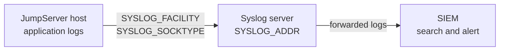

# Log Forwarding & SIEM

JumpServer can forward application logs to an external Syslog server, so that the
records survive the loss of a JumpServer host and can be collected, searched, and
correlated in a SIEM. The forwarded messages carry a JSON payload that includes
user, address, organization, and operation fields, which makes them suitable for
SIEM parsing.

## Overview

The flow has three parts:



The forwarded records include login, file transfer, operation, password change,
session, and command logs; see [Log payload format](#log-payload-format).

- Every component writes its logs under `VOLUME_DIR`, `/data/jumpserver` by
  default. The per-component directories are listed in
  [Troubleshooting](/operations/troubleshooting).
- Forwarding is enabled by deployment settings in
  `/opt/jumpserver/config/config.txt`: `SYSLOG_ENABLE`, `SYSLOG_ADDR`,
  `SYSLOG_FACILITY`, and `SYSLOG_SOCKTYPE`. The change takes effect after a
  service restart. See [Configuration](/operations/configuration) and
  [Integrations](/developer-guide/integrations).
- The collector receives an application log stream, not the audit database.
  Login, operation, and session records remain in JumpServer and are reviewed in
  **Audits**; the Syslog stream is a copy of selected application logs, not a
  replacement for the audit records.

<Alert type="note">
  The Syslog target is deployment configuration, so one target applies to the
  whole host. Transport security (TLS/RELP) and the accepted values of
  `SYSLOG_SOCKTYPE` are not documented; read the sections below before you plan
  a SIEM integration.
</Alert>

## Syslog settings

The settings are deployment configuration in
`/opt/jumpserver/config/config.txt`:

| Setting           | Purpose                | Notes                                                                                                                        |
| ----------------- | ---------------------- | ---------------------------------------------------------------------------------------------------------------------------- |
| `SYSLOG_ENABLE`   | Enables log forwarding | Set to `true`. Forwarding does not start while the value is missing or false.                                                |
| `SYSLOG_ADDR`     | Syslog server address  | Use `<address>:<port>`, for example `10.1.12.116:514`. The address can be an IP address or a host name.                      |
| `SYSLOG_FACILITY` | Syslog facility        | Facility attached to the forwarded messages, for example `local2`. Match the facility that your collector routes and stores. |
| `SYSLOG_SOCKTYPE` | Socket type            | Transport used to send messages. The accepted values are not documented; match the transport that your collector listens on. |

<Alert type="note">
  **Pending confirmation:** the accepted values of `SYSLOG_SOCKTYPE`, whether
  transport security (TLS/RELP) is supported, and whether every component honors
  the deployment Syslog settings. Do not assume that the stream is encrypted.
</Alert>

## Enable forwarding

<Steps>

<div>

Back up the deployment configuration file.

```sh
cp /opt/jumpserver/config/config.txt /opt/jumpserver/config/config.txt.bak.$(date +%F)
```

</div>

<div>

Set the Syslog values in `config.txt`. The address includes the port, and the
facility must match the collector configuration.

```text
# Enable Syslog forwarding
SYSLOG_ENABLE=true
# IP address and port of the Syslog server
SYSLOG_ADDR=10.1.12.116:514
# Facility used by the collector
SYSLOG_FACILITY=local2
SYSLOG_SOCKTYPE=<socket-type>
```

</div>

<div>

Restart the services so the containers read the new values.

```sh
./jmsctl.sh restart
```

</div>

<div>
  Send a test message and confirm that the collector receives it. See [Retention
  and validation](#retention-and-validation).
</div>

</Steps>

<Alert type="warning">
  `./jmsctl.sh restart` interrupts active sessions. Apply the change in a
  maintenance window and notify users first.
</Alert>

## Collector preparation

A standard Linux Syslog server can receive the messages. The example below uses
`rsyslog` with UDP on port `514` and stores the messages in a dedicated file.

<Steps>

<div>

Enable UDP reception and route the JumpServer facility in `/etc/rsyslog.conf`:

```text
# Receive Syslog over UDP on port 514
$ModLoad imudp
$UDPServerRun 514

# Store messages sent with the facility configured in SYSLOG_FACILITY
local2.*    /var/log/jumpserver/messages
```

</div>

<div>

Restart the collector service.

```sh
systemctl restart rsyslog
```

</div>

<div>

Send a test message from the JumpServer host, replacing the address with your
collector.

```sh
logger -n 10.1.12.116 -d -P 514 -p local2.info "message: rsyslog logging from JumpServer (UDP)"
```

</div>

<div>
  Confirm that the message appears in the collector output file before you
  continue. If it does not, check the UDP listener and the firewall between the
  hosts.
</div>

</Steps>

## Log payload format

Each forwarded message is a Syslog line followed by a structured JSON payload.
The payload starts after the `jumpserver: <log_name>-` marker:

```text
Apr 19 15:31:29 10.1.14.125 jumpserver: host_session_log - {"account":"root(root)","asset":"10.1.12.182-root(10.1.12.182)","date_start":"2023/04/19 15:24:54 +0800","is_success":true,"login_from":{"label":"Web Terminal","value":"WT"},"org_name":"Default","protocol":"ssh","remote_addr":"10.1.10.35","user":"Administrator(admin)"}
```

The log name identifies the record type:

| Log name              | Content                                                                                        |
| --------------------- | ---------------------------------------------------------------------------------------------- |
| `login_log`           | Authentication attempts, including backend, MFA state, status, source address, and user agent. |
| `ftp_log`             | File uploads and downloads, with account, asset, filename, and result.                         |
| `operation_log`       | Changes in the console, with the action, resource, resource type, and organization.            |
| `password_change_log` | Platform password changes, with the modifier and affected user.                                |
| `host_session_log`    | Session start and end records, with account, asset, protocol, login source, and session state. |
| `session_command_log` | Commands executed in a session, with input, output, risk level, and session identifier.        |

<Alert type="important">
  `session_command_log` includes the command output. Treat the Syslog stream as
  sensitive data: restrict collector and SIEM access, and apply the same
  retention and masking policy that you apply to session records.
</Alert>

<Alert type="note">
  The payload is JSON, not CEF or LEEF. Parse it after the `jumpserver:
  <log_name>-` marker, and keep the Syslog header for the timestamp, host, and
  facility. Field sets can differ between record types; build parsers per log
  name.
</Alert>

## Coverage matrix

The table lists where each source writes locally and whether this documentation
states that it is forwarded. The deployment setting is documented at the host
level, not per component.

| Source                          | What is logged                                                                                 | Local location                      | Forwarding status                                      |
| ------------------------------- | ---------------------------------------------------------------------------------------------- | ----------------------------------- | ------------------------------------------------------ |
| Core application logs           | Login, file transfer, operation, password change, session, and command records (JSON payloads) | `/data/jumpserver/core/data/logs`   | Documented: forwarded through the `SYSLOG_*` settings  |
| Celery                          | Background task logs, same directory as Core                                                   | `/data/jumpserver/core/data/logs`   | Not documented separately; verify with your deployment |
| KoKo                            | Terminal and SSH component logs                                                                | `/data/jumpserver/koko/data/logs`   | Not documented separately; verify                      |
| Chen                            | Web database component logs                                                                    | `/data/jumpserver/chen/data/logs`   | Not documented separately; verify                      |
| Razor                           | RDP proxy logs                                                                                 | `/data/jumpserver/razor/data/logs`  | Not documented separately; verify                      |
| Magnus                          | Database proxy logs                                                                            | `/data/jumpserver/magnus/data/logs` | Not documented separately; verify                      |
| Web (Nginx)                     | Proxy and access logs                                                                          | `/data/jumpserver/nginx/data/logs`  | Not documented separately; verify                      |
| PostgreSQL and Redis (built-in) | Database and cache container logs                                                              | Container logs; path not documented | Not covered by the documented Syslog settings          |
| Audit database records          | Login, operation, and session records stored in the JumpServer database                        | **Audits**                          | Not forwarded by Syslog; review in the product         |

<Alert type="note">
  **Pending confirmation:** whether the component runtime logs (KoKo, Chen, Razor,
  Magnus, Web) and the built-in PostgreSQL and Redis containers are also forwarded
  by the deployment settings. **System Settings > Components > Log** shows
  component log streaming when log collection is enabled, but its relationship to
  the `SYSLOG_*` settings is not documented.
</Alert>

## Transport security

The documented example uses UDP on port `514`, and `SYSLOG_SOCKTYPE` selects the
transport. TLS and RELP are not documented, and the message body is plain JSON.
If encrypted transport is a requirement, raise it with the vendor before the
integration is planned.

Do not expose the collector to untrusted networks, and do not put a TLS terminator
in front of a plain Syslog stream and assume that the forwarded messages are
authenticated.

## Multi-node aggregation

Each JumpServer node has its own deployment configuration. To aggregate a
multi-node deployment:

- Point every node's `SYSLOG_ADDR` at the same collector so that all application
  logs arrive in one place.
- Distinguish the nodes at the collector by source address, because all nodes can
  use the same facility and format.
- Configure NTP on every node with `./jmsctl.sh config ntp` so that timestamps
  from different nodes line up in the SIEM. See
  [Command-Line Tools](/operations/cli-tools).
- Restart the services on each node after editing its configuration, following the
  order described in [Upgrade & Maintenance](/operations/upgrade-maintenance).

<Alert type="note">
  **Pending confirmation:** a shared or high-availability recommendation for the
  Syslog configuration itself. This documentation does not state whether nodes
  must share the same `SYSLOG_*` values or can use different ones; the guidance
  above is the general approach for per-host configuration.
</Alert>

## Retention and validation

Retention is a collector-side decision. JumpServer documents retention for its own
records, not for forwarded logs, and the regular clean-up under **System Settings >
System Tasks > Regular clean-up** applies to platform records, not to the Syslog
stream. Set the retention period on the collector to match the audit policy.

Validate delivery in the order below:

<Steps>

<div>
  Confirm that the collector is reachable from the JumpServer host on the
  address and port in `SYSLOG_ADDR`, and that the transport matches your
  `SYSLOG_SOCKTYPE`. Confirm that the outbound direction is allowed; see
  [Network Ports](/operations/network-ports).
</div>

<div>

Send a test message from the host. The example uses UDP and the facility
configured above.

```sh
logger -n SYSLOG_HOST -d -P 514 -p local2.info "message: rsyslog logging from JumpServer (UDP)"
```

</div>

<div>

If the collector does not receive the test message, capture the traffic on the
host to confirm that the messages leave the interface. Use the port you
configured.

```sh
tcpdump -i any -nn port 514
```

</div>

<div>
  Trigger a real JumpServer event, such as a sign-in, an operation, or a session,
  and confirm that the corresponding `jumpserver: <log_name>-` line arrives with
  its JSON payload.
</div>

<div>
  Only after both messages arrive, write the SIEM parsing and alerting rules
  against the captured payloads, one parser per log name.
</div>

</Steps>

<Alert type="note">
  `logger` and `tcpdump` are host tools, not JumpServer commands. Skip a step
  when the tool is not installed on the host, and use the collector or a network
  capture point instead.
</Alert>

## Troubleshooting

| Symptom                                             | What to check                                                                                                                                                              |
| --------------------------------------------------- | -------------------------------------------------------------------------------------------------------------------------------------------------------------------------- |
| No messages arrive                                  | `SYSLOG_ENABLE=true`; restart completed after the edit; `SYSLOG_ADDR` reachable on the configured port; outbound rules; `SYSLOG_SOCKTYPE` matches the collector's listener |
| The test message arrives but JumpServer logs do not | `LOG_LEVEL` in `config.txt`; whether the component writes the event locally first; component log for errors in the forwarding path                                         |
| Messages arrive but the SIEM cannot parse them      | The payload is JSON after the `jumpserver: <log_name>-` marker; build one parser per log name and do not expect CEF/LEEF                                                   |
| Messages stop after an upgrade                      | Re-check the `SYSLOG_*` values in `config.txt` after the upgrade, then restart the services                                                                                |
| Timestamps disagree across nodes                    | NTP configuration on every node; collector time zone settings                                                                                                              |
| The same message appears more than once             | More than one forwarding path is configured; confirm that each host sends to exactly one collector                                                                         |
| Sensitive data appears in the SIEM                  | `session_command_log` includes command output; restrict SIEM access and apply masking or retention rules there                                                             |

For the general diagnostic flow, see [Troubleshooting](/operations/troubleshooting).
For the ports the platform itself needs, see
[Network Ports](/operations/network-ports).

## Related topics

- [Security Hardening](/operations/security-hardening)
- [Configuration](/operations/configuration)
- [Network Ports](/operations/network-ports)
- [Troubleshooting](/operations/troubleshooting)
- [Integrations](/developer-guide/integrations)
